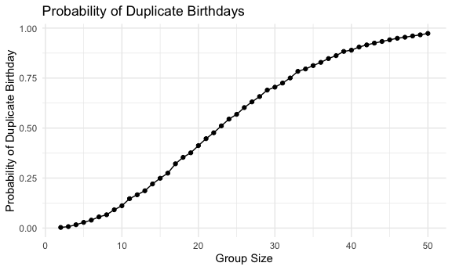

p8105_hw5_mts2203
================
Madeline Sharp
2026-11-14

# Problem 0

## Setting up

# Problem 1

## Writing Birthday Function

``` r
# writing birthday function 
duplicate_birthdays = function(n) {
  
  # drawing “birthdays” for each person randomly
  birthdays = sample(1:365, n, replace = TRUE)

  # checking for duplicate birthdays
  duplicate_birthdays = length(unique(birthdays)) < n
  
  # returning duplicate birthdays
  return(duplicate_birthdays)
}
```

## Running Simulations

``` r
# simulating function and computing prob. that <= 2 people will share a birthday
birthday_probabilities_df =
  expand_grid(
    number_of_people = 2:50,
    iter = 1:10000
  ) |> 
  mutate(
    duplicates = map_lgl(number_of_people, duplicate_birthdays) 
  ) |>
   group_by(number_of_people) |>
  summarize(
    probability = mean(duplicates)
  ) |>
  print()
```

    ## # A tibble: 49 × 2
    ##    number_of_people probability
    ##               <int>       <dbl>
    ##  1                2      0.0032
    ##  2                3      0.0074
    ##  3                4      0.0167
    ##  4                5      0.0285
    ##  5                6      0.0398
    ##  6                7      0.0559
    ##  7                8      0.0667
    ##  8                9      0.0916
    ##  9               10      0.112 
    ## 10               11      0.147 
    ## # ℹ 39 more rows

## Plotting Probabilities

``` r
# making a plot showing the probability as a function of group size
birthday_probabilities_df |> 
  ggplot(aes(x = number_of_people, y = probability)) + 
  geom_point() + 
  geom_line() +
  labs(
    title = "Probability of Duplicate Birthdays",
    x = "Group Size",
    y = "Probability of Duplicate Birthday"
  )
```



## Commenting on the Results

The `birthday_probabilities_df` plot shows that as group size increases
so does the probability of duplicate birthdays, assuming each person is
randomly assigned a birthday. Looking at the *Probability of Duplicate
Birthdays* plot, this increase is initially gradual, but becomes much
steeper as group size grows. As the group size approaches 50, the
probability of at least one duplicate birthday approaches 1.00. At group
size 23, this probability is already approximately 0.50.

# Problem 2

## Creating the Data Frame

``` r
# creating the data frame containing all file names
participants_df =
  participant_files =
  tibble(
    files = list.files("data/"),
    path = str_c("data/", files)
  ) |>
  print()
```

    ## # A tibble: 20 × 2
    ##    files      path           
    ##    <chr>      <chr>          
    ##  1 con_01.csv data/con_01.csv
    ##  2 con_02.csv data/con_02.csv
    ##  3 con_03.csv data/con_03.csv
    ##  4 con_04.csv data/con_04.csv
    ##  5 con_05.csv data/con_05.csv
    ##  6 con_06.csv data/con_06.csv
    ##  7 con_07.csv data/con_07.csv
    ##  8 con_08.csv data/con_08.csv
    ##  9 con_09.csv data/con_09.csv
    ## 10 con_10.csv data/con_10.csv
    ## 11 exp_01.csv data/exp_01.csv
    ## 12 exp_02.csv data/exp_02.csv
    ## 13 exp_03.csv data/exp_03.csv
    ## 14 exp_04.csv data/exp_04.csv
    ## 15 exp_05.csv data/exp_05.csv
    ## 16 exp_06.csv data/exp_06.csv
    ## 17 exp_07.csv data/exp_07.csv
    ## 18 exp_08.csv data/exp_08.csv
    ## 19 exp_09.csv data/exp_09.csv
    ## 20 exp_10.csv data/exp_10.csv

## Adding Participant Data to the Dataframe

``` r
# iterating over file names and read in data for each subject 
participants_df |>   
  mutate(
    data = map(path,read_csv)
  ) |>
  unnest(data)
```

    ## # A tibble: 20 × 10
    ##    files      path       week_1 week_2 week_3 week_4 week_5 week_6 week_7 week_8
    ##    <chr>      <chr>       <dbl>  <dbl>  <dbl>  <dbl>  <dbl>  <dbl>  <dbl>  <dbl>
    ##  1 con_01.csv data/con_…   0.2   -1.31   0.66   1.96   0.23   1.09   0.05   1.94
    ##  2 con_02.csv data/con_…   1.13  -0.88   1.07   0.17  -0.83  -0.31   1.58   0.44
    ##  3 con_03.csv data/con_…   1.77   3.11   2.22   3.26   3.31   0.89   1.88   1.01
    ##  4 con_04.csv data/con_…   1.04   3.66   1.22   2.33   1.47   2.7    1.87   1.66
    ##  5 con_05.csv data/con_…   0.47  -0.58  -0.09  -1.37  -0.32  -2.17   0.45   0.48
    ##  6 con_06.csv data/con_…   2.37   2.5    1.59  -0.16   2.08   3.07   0.78   2.35
    ##  7 con_07.csv data/con_…   0.03   1.21   1.13   0.64   0.49  -0.12  -0.07   0.46
    ##  8 con_08.csv data/con_…  -0.08   1.42   0.09   0.36   1.18  -1.16   0.33  -0.44
    ##  9 con_09.csv data/con_…   0.08   1.24   1.44   0.41   0.95   2.75   0.3    0.03
    ## 10 con_10.csv data/con_…   2.14   1.15   2.52   3.44   4.26   0.97   2.73  -0.53
    ## 11 exp_01.csv data/exp_…   3.05   3.67   4.84   5.8    6.33   5.46   6.38   5.91
    ## 12 exp_02.csv data/exp_…  -0.84   2.63   1.64   2.58   1.24   2.32   3.11   3.78
    ## 13 exp_03.csv data/exp_…   2.15   2.08   1.82   2.84   3.36   3.61   3.37   3.74
    ## 14 exp_04.csv data/exp_…  -0.62   2.54   3.78   2.73   4.49   5.82   6      6.49
    ## 15 exp_05.csv data/exp_…   0.7    3.33   5.34   5.57   6.9    6.66   6.24   6.95
    ## 16 exp_06.csv data/exp_…   3.73   4.08   5.4    6.41   4.87   6.09   7.66   5.83
    ## 17 exp_07.csv data/exp_…   1.18   2.35   1.23   1.17   2.02   1.61   3.13   4.88
    ## 18 exp_08.csv data/exp_…   1.37   1.43   1.84   3.6    3.8    4.72   4.68   5.7 
    ## 19 exp_09.csv data/exp_…  -0.4    1.08   2.66   2.7    2.8    2.64   3.51   3.27
    ## 20 exp_10.csv data/exp_…   1.09   2.8    2.8    4.3    2.25   6.57   6.09   4.64
